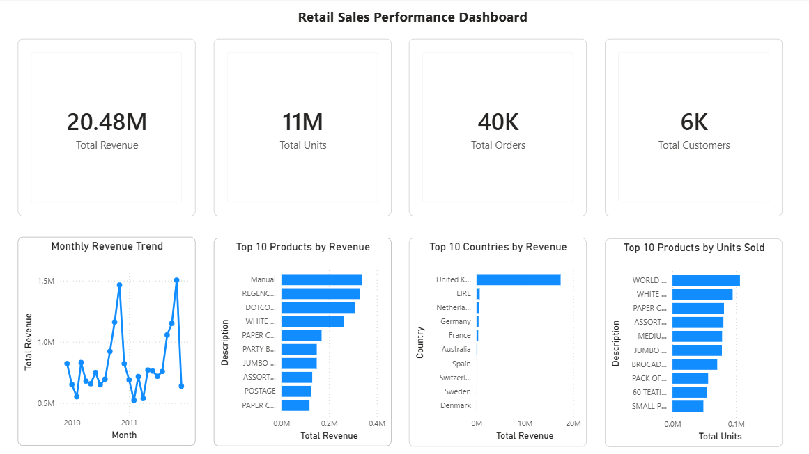

# Retail Sales Performance Analysis

## Project Overview

This project analyzes transactional retail sales data to evaluate overall business performance, identify sales trends, and understand the products and markets contributing most to revenue and unit sales.

The analysis follows an end-to-end data analytics workflow using Excel and Power Query for data preparation, MySQL for analytical querying, and Power BI for KPI reporting and visualization.

## Tools & Technologies

- Excel
- Power Query
- MySQL
- SQL
- Power BI
- DAX

## Data Preparation

The raw retail dataset was audited and transformed using Excel and Power Query before analysis.

Key preparation steps included:

- Combining the source retail data
- Reviewing missing values and data-quality issues
- Identifying cancelled invoices
- Reviewing negative quantities and non-positive prices
- Removing cancelled transactions from the analytical dataset
- Keeping positive sales quantities
- Removing duplicate records
- Creating a Revenue field
- Creating date-based fields for time analysis
- Producing a cleaned sales dataset for SQL and Power BI analysis

The final analytical dataset contains 1,007,913 sales records.

## SQL Analysis

The cleaned dataset was imported into MySQL and analyzed using SQL.

The analysis focused on:

- Overall sales KPIs
- Monthly sales trends
- Top 10 products by revenue
- Top 10 products by units sold
- Top 10 countries by revenue

The SQL scripts used in the analysis are available in the sql folder.

## Key Performance Indicators

| KPI | Result |
| ---|---:|
| Total Revenue | 20,476,260.45 |
| Total Units Sold | 11,205,148 |
| Total Orders | 40,077 |
| Total Customers | 5,879

## Power BI Dashboard

A Power BI dashboard was developed to summarize the key results of the analysis.

The dashboard includes:

- Total Revenue
- Total Units Sold
- Total Orders
- Total Customers
- Monthly Revenue Trend
- Top 10 Products by Revenue
- Top 10 Countries by Revenue
- Top 10 Products by Units Sold



The Power BI file is available in the `powerbi` folder.

## Key Insights

- The dataset generated approximately 20.48 million in total revenue from more than 11.2 million units sold.
- Approximately 40,000 unique orders were recorded across the analyzed period.
- Sales performance varies substantially by month, with pronounced revenue peaks visible in the monthly trend.
- Revenue is geographically concentrated, with the United Kingdom contributing substantially more revenue than other countries in the dataset.
- Product rankings differ between revenue and unit sales, showing that the highest-volume products are not necessarily the highest-revenue products.
- The top-product and country analyses highlight where product demand and geographic sales concentration are strongest.

## Repository Structure
```
retail-demand-forecasting/
├── data/       # Source data
├── docs/       # Data source documentation
├── excel/      # Excel, Power Query, and cleaned dataset files
├── images/     # Dashboard image
├── powerbi/    # Power BI dashboard
├── sql/        # SQL scripts
└── README.md
```
